# Assignment 6. jQuery (Selectors, Effects, Animations)

**Name:** Askar Bavgashev
**Group:** SE-2540
**Student ID:** 242384

---

## Part 1. Getting Started with jQuery

### Task 0. Setup
Included jQuery 3.7.1 from the CDN, wrapped the code in `$(document).ready(...)` and printed "jQuery is ready!" to the console.

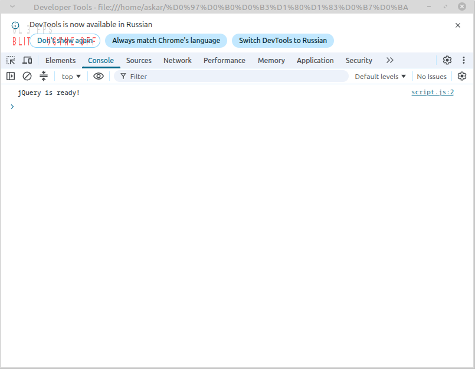

### Task 1. Selectors & CSS
Created a profile section with a title, name, headline and introduction. Used tag (`h1`), ID (`#headline`) and class (`.intro`) selectors, updated text with `.text()` / `.html()`, styled elements with `.css()`, and added Light / Dark theme buttons.

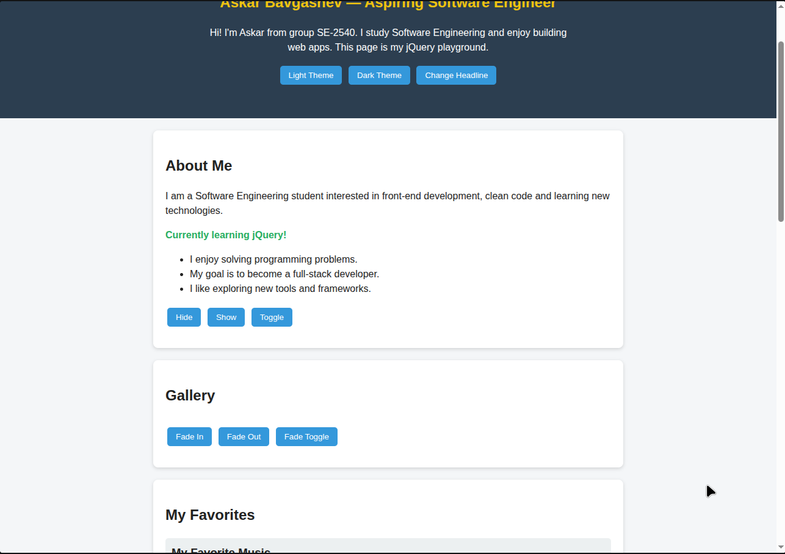
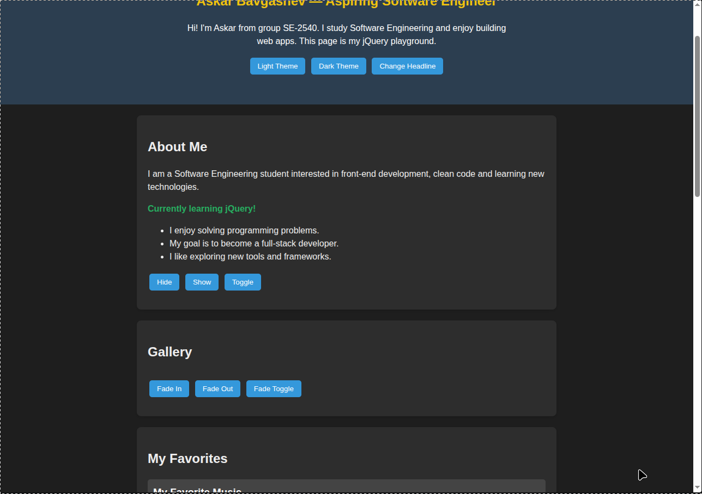

## Part 2. jQuery Effects

### Task 2. Visibility Methods
"About Me" section with a biography, status message and fun facts. Hide, Show and Toggle buttons use `.hide()`, `.show()` and `.toggle()`.

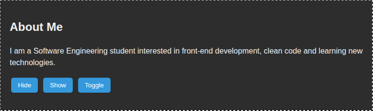
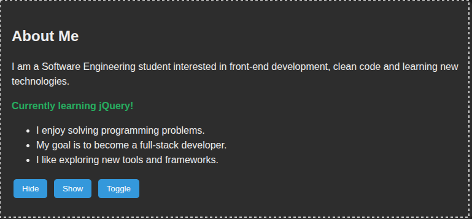

### Task 3. Fade Methods
Gallery with two images controlled by `.fadeIn()`, `.fadeOut()` and `.fadeToggle()`.

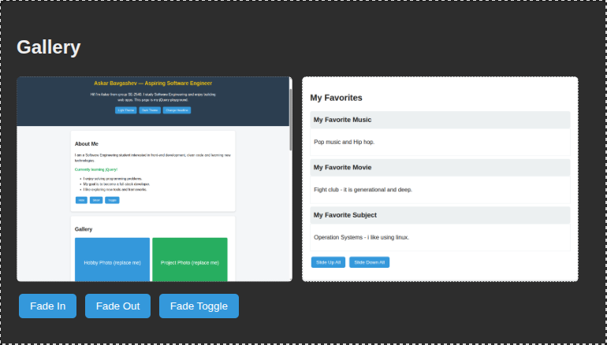
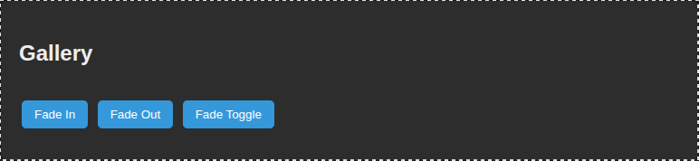

### Task 4. Slide Methods
Three clickable headings (Music, Movie, Subject) with collapsible panels using `.slideUp()`, `.slideDown()` and `.slideToggle()`.

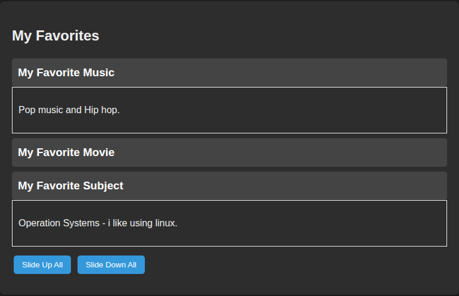

## Part 3. DOM Manipulation with jQuery

### Task 5. Add & Remove Elements
List of four skills, a text input, and buttons "Add Skill" (`.append()`), "Prepend Skill" (`.prepend()`) and "Remove Skill" (`.remove()`). Empty input is rejected with an error message.

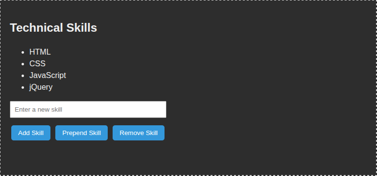
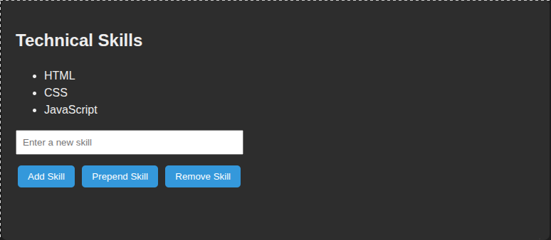
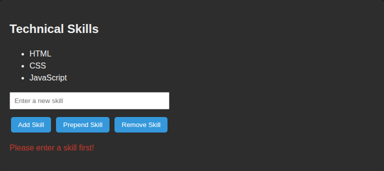

### Task 6. Modifying Attributes
A social link whose `href` is switched between GitHub and LinkedIn with `.attr()`.

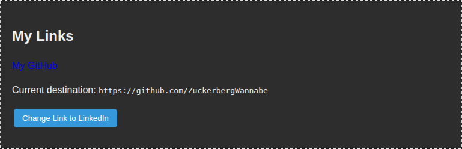
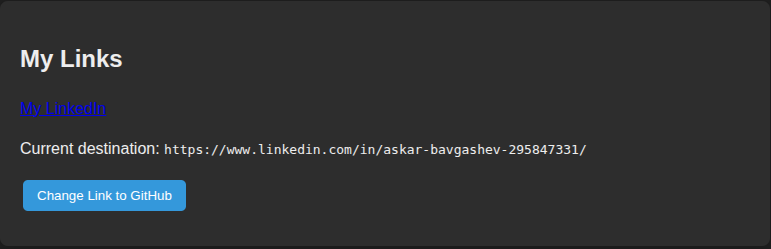

### Task 7. Form Interaction
Name and Email inputs; the typed values are shown live below the form using `.val()` and `.text()`.

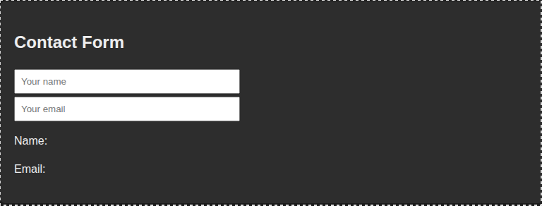
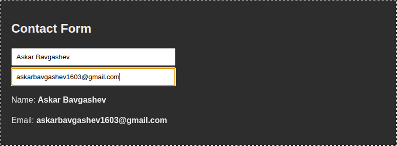

## Part 4. Animations

### Task 8. Basic Animation
Skill bars (HTML 90%, CSS 80%, JavaScript 70%, jQuery 55%) start at zero width. "Animate My Skills" animates them to their levels with `.animate()`; clicking again animates them back to zero.

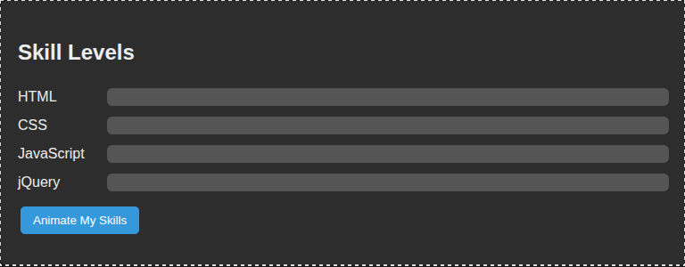
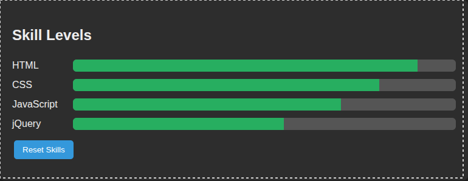

---

## Summary of Work Process
I started by setting up the HTML structure with one section per task and linking jQuery from the CDN. Then I implemented each task step by step in `script.js`: selectors and CSS first, then show/hide, fade and slide effects, then adding/removing elements, attributes and live form input, and finally the animated skill bars. I tested every button in the browser, checked the console for errors, took screenshots, and deployed the project with GitHub Pages.
